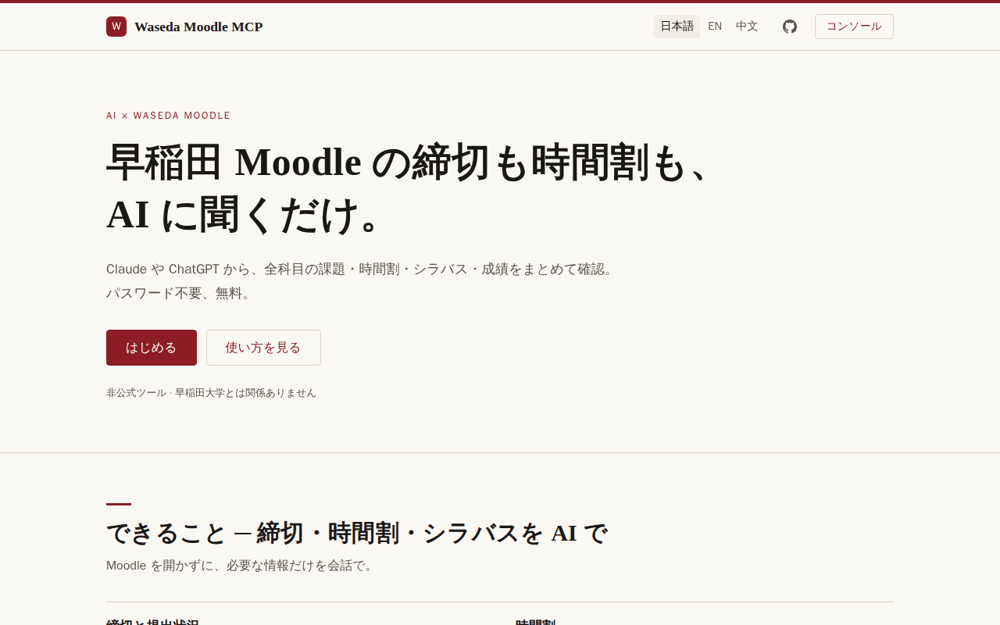
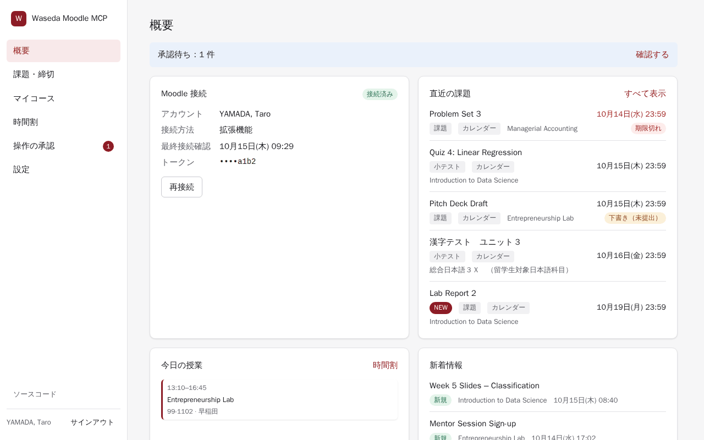
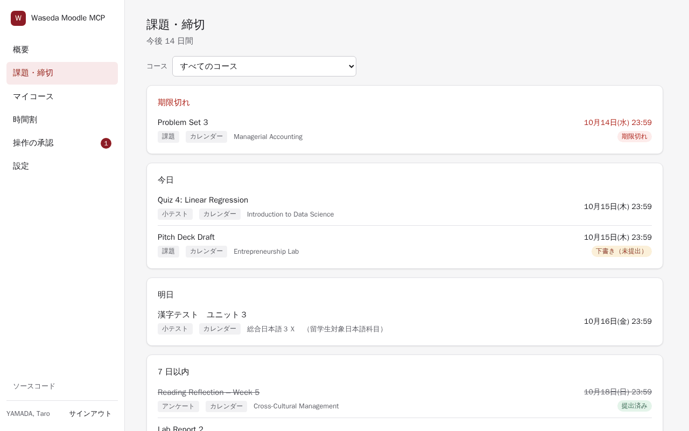
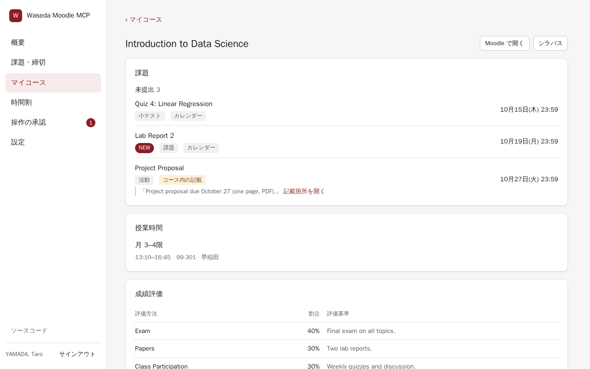
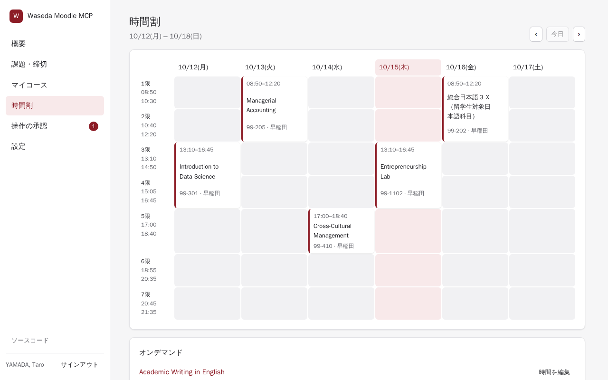

<div align="center">

# Waseda Moodle MCP

[English](README.md) · **日本語** · [简体中文](README.zh-CN.md)

**早稲田大学の Moodle（wsdmoodle）を Claude、ChatGPT、Cursor などの AI アシスタントにつなぐ MCP サーバー。**<br>
課題・締切、時間割、シラバス、成績、コースの新着情報を、話しかけるだけで確認できます。

[公開インスタンス](https://moodle.waseda-mcp.workers.dev) · [セルフホスト](docs/self-hosting.md) · [MIT ライセンス](LICENSE)



</div>

**早稲田大学の Moodle**（`https://wsdmoodle.waseda.jp`）向けの [MCP（Model Context Protocol）](https://modelcontextprotocol.io) サーバーです。
今週締切の課題、次の授業の時間と教室、コースの成績評価の方法、先生が最近掲載した内容などを、
すべてのコースを横断して Claude や ChatGPT などの AI アシスタントに質問できます。
早稲田大学専用の設計で、Moodle のオリジン、ログインフロー、いくつかの機能（シラバスに基づく
時間割、課題・締切の巡回）はこのサイトに特化しています。

Cloudflare Workers 上のホスト型サービス（Web コンソール付き）としても、ローカルの
stdio プロセスとしても動作します。非公式ツールであり、早稲田大学とは関係ありません。

**こんな質問ができます**

- 「今週締切の課題は？まだ提出していないのはどれ？」
- 「明日の授業は何がある？教室はどこ？」
- 「Introduction to Data Science の成績評価はどうなってる？」
- 「月曜日以降、先生がコースに追加したものは？」

## スクリーンショット

| 概要 | 課題・締切 |
|---|---|
|  |  |
| **マイコース** | **時間割** |
|  |  |

<sub>スクリーンショットは架空のデモデータです。</sub>

## 機能

**課題・締切**
- 未完了の項目を 期限切れ / 今日 / 明日 / 7 日以内 / それ以降 で、またはコース別（`group_by=course`）にまとめて表示。提出済みの項目は取り消し線付きで同じグループに残ります。Moodle カレンダーに加え、日付のない活動やコース本文に書かれた締切を見つけるバックグラウンド巡回の結果も含みます（「要確認」付き）。
- コースで先生が最近追加・変更した内容。
- カレンダー購読：課題・締切と時間割を Google カレンダー、Apple カレンダー、Outlook で表示できる秘密の ICS 購読 URL（コンソールの **設定 → カレンダー購読**）。

**時間割**
- 日ごとの授業を時間、教室、キャンパス付きで表示。早稲田大学の公開シラバスと学年暦から作成します。オンデマンドや時間不明の授業は別に一覧表示。

**コース、コンテンツ、成績**
- 履修中のコース（既定は今学期）、確定したコース選択（**設定 → 今学期のコース**）、コースのセクションと活動、活動の詳細、コース横断の名前検索、コースごとの成績。

**フォーラム、メッセージ、通知**
- フォーラムのスレッドと投稿、Moodle の会話、未読数付きの通知。

**ファイル**
- Moodle のファイルを短時間有効な署名付き URL（ホスト型）または一時ファイル（stdio）でダウンロード。小さなファイルはインラインで添付できます。

**書き込みはプレビュー後に確定**
- 課題の提出（テキストとファイル）、フォーラムへの投稿と返信、Moodle メッセージ、手動での完了マーク。
- すべての書き込みは 2 段階です。`prepare_*` がプレビューを返し、同意のうえで `confirm_action` を実行するまで Moodle には何も送られません。Web コンソールで書き込みを承認制にしたり、無効にしたりすることもできます。

## 仕組み

サーバーは、公式 Moodle モバイルアプリと同じトークンを使って Moodle の Web サービスと通信します。
このトークンは、ブラウザで Moodle にサインインした状態で Moodle のモバイルアプリ起動フローから
取得します。パスワードを求めたり、見たりすることはありません。

```
AI client  <-- MCP (HTTP or stdio) -->  MCP server (Worker / Node)  <-- REST -->  Moodle web services
                                              |
                                        D1 / KV (hosted)
```

## クイックスタート

**公開インスタンス** — Konata が運営する無料の公開インスタンス：

1. [公開インスタンス](https://moodle.waseda-mcp.workers.dev) を開き、ブックマークレット、ブラウザ拡張機能、
   または起動リンクの貼り付けで Moodle を接続します。パスワードを求められることはありません。
2. 必要に応じて **設定 → 今学期のコース** で今学期のコースを確定します。
3. **設定 → AI 接続** から MCP URL をコピーし、AI クライアントに追加します（[クライアント](#クライアント) を参照）。

**自分のインスタンス** — [セルフホスト](#セルフホスト) を参照してください。以下、`https://wasemoodle.example.com` は
あなたのインスタンスの URL を表します。

## コンソール

ホスト型コンソールのサイドバー：**概要**、**課題・締切**、**マイコース**、**時間割**、**操作の承認**、**設定**。

**マイコース** はコース別のビューです（課題、時間割、シラバスの成績評価、新着情報）。出席するコースは **設定 → 今学期のコース** で確定します。

設定のタブ：**一般**、**今学期のコース**、**AI 接続**、**API キー**、**連携アプリ**、**カレンダー購読**、**アクティビティ**、**アカウント**。

## クライアント

MCP URL：`https://wasemoodle.example.com/mcp`（Streamable HTTP）。既定は OAuth です。クライアントは
`401` レスポンスから認可サーバーを検出し（RFC 9728）、自身を登録して同意ページを開きます。そこで
読み取り専用または読み書きのアクセスを許可します。API キー（`wmm_…`、コンソールの **設定 → API キー** で作成）は
`Authorization: Bearer <API_KEY>` ヘッダーを送れるクライアント向けです。
コンソールの **設定 → AI 接続** ページには、インスタンスの URL を埋め込んだ同じ手順が表示されます。

| クライアント | 設定 |
|---|---|
| Claude（Web、デスクトップ。追加後はモバイルでも利用可） | カスタマイズ → コネクタ → カスタムコネクタを追加 → URL → 接続。Free プラン：カスタムコネクタ 1 個まで。Team/Enterprise：オーナーが組織設定 → コネクタで追加。 |
| ChatGPT | プラグイン → + → カスタム MCP サーバーを追加 → URL、認証 OAuth → 作成。Plus、Pro、Business、Enterprise、Edu で利用可。 |
| Grok | grok.com/connectors → New Connector → Custom → URL。Business/Enterprise：先に管理者が console.x.ai で追加。 |
| Claude Code | `claude mcp add --transport http waseda-moodle https://wasemoodle.example.com/mcp` の後、`/mcp` → Authenticate |
| Cursor | `~/.cursor/mcp.json`: `{"mcpServers": {"waseda-moodle": {"url": "https://wasemoodle.example.com/mcp"}}}` |
| VS Code (Copilot) | `.vscode/mcp.json`: `{"servers": {"waseda-moodle": {"type": "http", "url": "https://wasemoodle.example.com/mcp"}}}` |
| Codex CLI | `codex mcp add waseda-moodle --url https://wasemoodle.example.com/mcp` の後、`codex mcp login waseda-moodle` |
| Gemini CLI | `gemini mcp add --transport http waseda-moodle https://wasemoodle.example.com/mcp` の後、`/mcp auth waseda-moodle`（無料ユーザーと Google One ユーザーは現在 Antigravity CLI を使用） |
| Grok CLI | `grok mcp add --transport http waseda-moodle https://wasemoodle.example.com/mcp` |
| その他（LobeHub、Cherry Studio など） | Streamable HTTP + URL。対応していれば OAuth、なければ API キーヘッダー |

**API キーを使う場合**（OAuth の代わり）。キーはプロジェクトファイルに置かないでください。CLI はユーザー設定に
保存し、Codex と Cursor は `WMM_API_KEY` から読み取ります（シェルのプロファイルで設定します。例：
`~/.zshrc` に `export WMM_API_KEY='<API_KEY>'`）。

```sh
# Claude Code / Grok CLI（OAuth コマンドの代わりに。追加済みの場合は先に `claude mcp remove waseda-moodle`）
claude mcp add --transport http waseda-moodle https://wasemoodle.example.com/mcp \
  --header "Authorization: Bearer <API_KEY>"
grok mcp add --transport http waseda-moodle https://wasemoodle.example.com/mcp \
  --header "Authorization: Bearer <API_KEY>"
# Codex
codex mcp add waseda-moodle --url https://wasemoodle.example.com/mcp --bearer-token-env-var WMM_API_KEY
```

Cursor（`~/.cursor/mcp.json`）：サーバーエントリに `"headers": { "Authorization": "Bearer ${env:WMM_API_KEY}" }` を
追加します。VS Code（`.vscode/mcp.json`）：VS Code にキーを入力させ、安全に保存させます。

```json
{
  "inputs": [
    { "type": "promptString", "id": "wmm-api-key", "description": "Waseda Moodle MCP API key", "password": true }
  ],
  "servers": {
    "waseda-moodle": {
      "type": "http",
      "url": "https://wasemoodle.example.com/mcp",
      "headers": { "Authorization": "Bearer ${input:wmm-api-key}" }
    }
  }
}
```

Gemini CLI（`~/.gemini/settings.json`、`httpUrl` を使用）：サーバーエントリに
`"headers": { "Authorization": "Bearer <API_KEY>" }` を追加します。ChatGPT と Claude
（Web）は OAuth のみです。

**ローカル stdio**（Node 20+）：

```sh
pnpm install
pnpm build:stdio                                  # dist/stdio.js を生成
node dist/stdio.js connect -                      # 起動リンクを stdin に貼り付け
```

クライアント設定（多くのクライアントで使われる JSON 形式）：

```json
{
  "mcpServers": {
    "waseda-moodle": {
      "command": "node",
      "args": ["/path/to/waseda-moodle-mcp/dist/stdio.js"]
    }
  }
}
```

Claude Code の場合：`claude mcp add waseda-moodle -- node /path/to/dist/stdio.js --read-only`。

| オプション | 意味 |
|---|---|
| `--read-only` / `WMM_READ_ONLY=1` | 読み取りツールのみ登録 |
| `WMM_TOKEN` | トークンまたは起動リンク。トークンファイルより優先 |
| `WMM_CONFIG_DIR` | 設定ディレクトリ（既定 `~/.config/waseda-moodle-mcp`。トークンファイルのモードは 0600） |
| `HTTPS_PROXY`, `ALL_PROXY`, `NO_PROXY` | 外向きプロキシの設定 |

stdio はトークンを平文で保存し（ファイルモード 0600）、コンソールでの書き込み承認や
`create_upload_link` には対応していません。

## ツール

| ツール | 用途 | アクセス |
|---|---|---|
| `get_due_items` | 課題・締切を日別またはコース別（`group_by=course`）にまとめて取得。提出済みは取り消し線付きで同じグループに残る。提出状況と巡回結果を含む | read |
| `list_courses` | 履修中のコース（`scope`：`mine` または `all`） | read |
| `get_course` | 1 コースのセクションと活動 | read |
| `search_course_content` | 活動・セクション・ファイル名を検索 | read |
| `get_activity` | 1 活動の詳細 | read |
| `get_grades` | コースの成績 | read |
| `set_my_courses` | コース選択（今学期のコース）を保存。サーバー側のフィルタで、Moodle は変更しない | read スコープ |
| `get_course_updates` | 先生による最近の変更 | read |
| `get_timetable` | 日ごとの授業（教室・キャンパス付き） | read |
| `set_course_schedule` | コースの授業時間を設定・解除。サーバー側で、Moodle は変更しない | read スコープ |
| `get_syllabus` | 公開シラバス：授業計画、成績評価の配分、教科書 | read |
| `get_quiz_review` | 終了した小テストの受験を確認（問題、得点、正答） | read |
| `get_file` | Moodle のファイルを取得（署名付き URL、一時ファイル、または 1 MiB までインライン） | read |
| `list_discussions` | フォーラムのスレッド（既定：お知らせ） | read |
| `get_discussion` | 1 ディスカッションの投稿 | read |
| `list_messages` | Moodle の会話 | read |
| `get_conversation` | 1 会話のメッセージ | read |
| `list_notifications` | 通知と未読数 | read |
| `search_forums` | フォーラムのディスカッションをキーワード検索（メッセージも任意で対象） | read |
| `search_people` | コースのフォーラムや会話に登場した先生・クラスメートを検索 | read |
| `create_upload_link` | 大きなファイル用の短時間有効なアップロード URL（ホスト型のみ） | write |
| `prepare_submission` | 課題提出のプレビュー | write |
| `prepare_forum_post` | フォーラム投稿・返信のプレビュー | write |
| `prepare_message` | Moodle メッセージのプレビュー | write |
| `prepare_completion` | 活動の完了 / 未完了マークのプレビュー | write |
| `prepare_forum_subscription` | フォーラム購読 / 購読解除のプレビュー | write |
| `prepare_mark_read` | 通知または会話を既読にする操作のプレビュー | write |
| `confirm_action` | 準備した操作を実行 | write |
| `cancel_action` | 準備した操作を破棄 | write |

プロンプト：`daily_briefing`（日付は任意）、`weekly_plan`、`exam_prep`（コース）。リソース：`moodle://course/{course_id}`
と `moodle://syllabus/{course_id}`。準備した操作は 30 分で期限切れになります。時刻は
JST で表示されます。サーバーが小テストを受験することはありません。

## セキュリティとプライバシー

- Moodle のパスワードを求めることは一切ありません。Moodle トークンは保存時に暗号化されます（運営者の `MASTER_KEY` による AES-256-GCM）。
- ファイルの内容はストリーミングされ、保存されません。ダウンロード・アップロードのリンクは HMAC 署名付きで、それぞれ 15 分・30 分で期限切れになります。
- API キーはハッシュとして保存されます。OAuth アクセストークンの有効期間は 12 時間、リフレッシュトークンは 90 日です。
- **設定 → アカウント** でアカウントを削除すると、サーバー上のあなたのデータはすべて削除されます。

詳細：[docs/privacy.md](docs/privacy.md)。

## セルフホスト

ホスト型は Cloudflare Workers の Free プラン（Worker + D1 + KV + 静的アセット）に収まります。
[docs/self-hosting.md](docs/self-hosting.md) を参照してください。

## 開発

| コマンド | 用途 |
|---|---|
| `pnpm dev` | `wrangler dev`（コンソールは `pnpm --filter waseda-moodle-mcp-web dev`） |
| `pnpm test` | Vitest（core、worker、node、extension） |
| `pnpm --filter waseda-moodle-mcp-web test` | コンソールのテスト |
| `pnpm typecheck` | TypeScript（ルートと `web/`） |
| `pnpm lint` / `pnpm lint:fix` | Biome |
| `pnpm dup` / `pnpm dead` | jscpd による重複検出 / knip によるデッドコード検出 |
| `pnpm quality` | lint + dup + dead + typecheck（テストは別途実行） |
| `pnpm build:stdio` | stdio サーバーをバンドル |

構成：`src/core`（ランタイム非依存のサービス、Moodle クライアント、MCP ツール）、`src/worker`
（Cloudflare エントリ、OAuth、API、D1 ストア、cron）、`src/node`（stdio CLI）、`web`（React コンソール）、
`extension`（MV3 コネクタ、ビルド不要）、`migrations`（D1 SQL）、`tests`。

## ライセンス

[MIT](LICENSE)。

## 免責事項

本プロジェクトは非公式ツールであり、早稲田大学とは関係がなく、早稲田大学の承認も受けていません。
使用する Moodle トークンは公式 Moodle モバイルアプリが使うものと同じです（ユーザーごとに 1 つ）。
このサーバーがトークンを失効・リセットすることはありません。Moodle に拒否された場合は、
再接続を求めるだけです。
