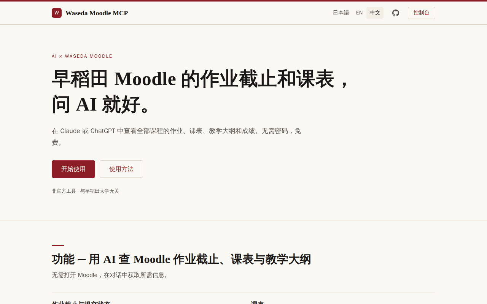
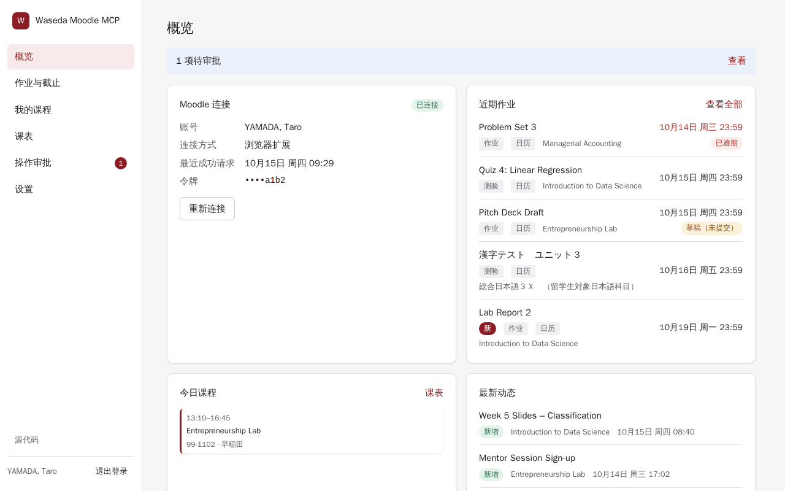
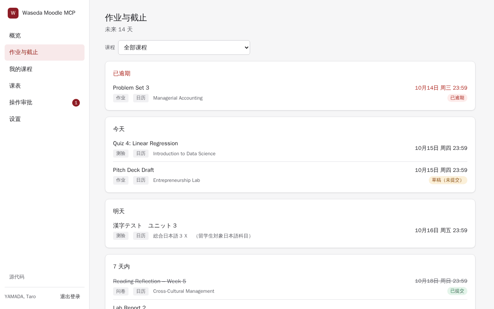
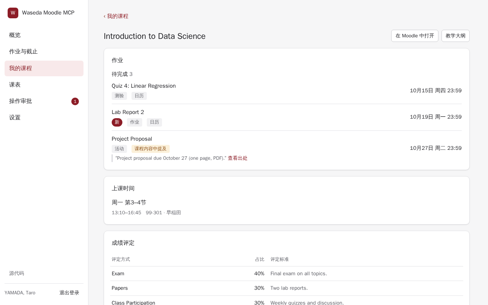
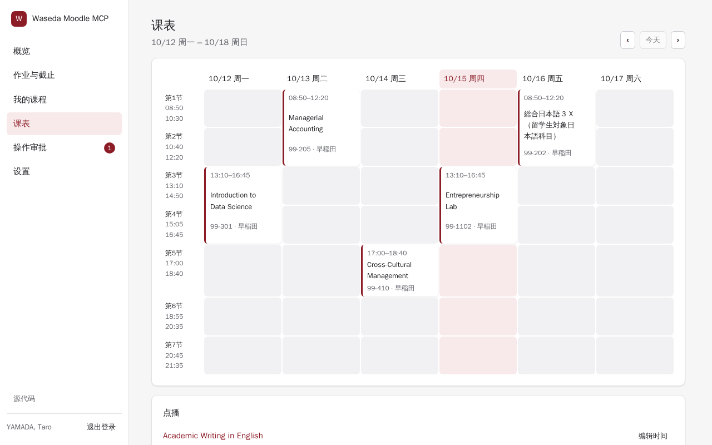

<div align="center">

# Waseda Moodle MCP

[English](README.md) · [日本語](README.ja.md) · **简体中文**

**把早稻田大学 Moodle（wsdmoodle）接入 Claude、ChatGPT、Cursor 等 AI 助手。**<br>
作业与截止、课表、教学大纲（Syllabus）、成绩和课程动态，问一句就知道。

[公共实例](https://moodle.waseda-mcp.workers.dev) · [自托管](docs/self-hosting.md) · [MIT 许可证](LICENSE)



</div>

这是一个面向**早稻田大学 Moodle**（`https://wsdmoodle.waseda.jp`）的 [MCP（Model Context Protocol）](https://modelcontextprotocol.io)服务器。你可以直接问 Claude、ChatGPT 等 AI 助手：这周有哪些作业要截止、下一节课在什么时间和教室、某门课的成绩怎么评定、老师最近发布了什么——一次覆盖所有课程。
它专为早稻田大学设计：Moodle 地址、登录流程以及多项功能（基于教学大纲的课表、作业与截止扫描）都针对该站点实现。

它既可以作为托管服务运行在 Cloudflare Workers 上（附带网页控制台），也可以作为本地 stdio 进程运行。非官方工具，与早稻田大学无关。

**你可以这样问**

- “这周有哪些作业要截止？哪些我还没交？”
- “明天有哪些课，分别在哪个教室？”
- “Introduction to Data Science 的成绩怎么评定？”
- “从周一到现在，老师在我的课程里加了什么？”

## 截图

| 概览 | 作业与截止 |
|---|---|
|  |  |
| **我的课程** | **课表** |
|  |  |

<sub>截图使用虚构的演示数据。</sub>

## 功能

**作业与截止**
- 未完成事项按“已逾期 / 今天 / 明天 / 未来 7 天 / 更晚”分组，也可按课程分组（`group_by=course`）。已提交的事项仍留在原分组中，并显示删除线。数据来自 Moodle 日历，并辅以后台扫描，找出没有设置日期的活动以及写在课程正文里的截止时间（标记为“请核实”）。
- 你的课程中老师最近新增和修改的内容。
- 日历订阅：一个私密的 ICS 订阅地址（控制台 **设置 → 日历订阅**），可把作业与截止和课表同步到 Google 日历、Apple 日历或 Outlook。

**课表**
- 按天列出课程的时间、教室和校区，根据早稻田公开的教学大纲和校历生成。按需（On-demand）课程和时间未知的课程单独列出。

**课程、内容与成绩**
- 已选课程（默认为本学期）、确认后的课程选择（**设置 → 本学期课程**）、课程章节与活动、活动详情、跨课程名称搜索、各课程成绩。

**论坛、消息与通知**
- 论坛帖子和回复、Moodle 会话、通知及未读数。

**文件**
- 通过短时有效的签名 URL（托管版）或临时文件（stdio）下载任意 Moodle 文件；小文件可直接内联附带。

**写操作先预览，再确认**
- 作业提交（文本和文件）、论坛发帖与回复、Moodle 消息、手动标记完成。
- 每次写操作都分两步：`prepare_*` 返回预览，只有在你同意后运行 `confirm_action`，内容才会发送到 Moodle。也可以在网页控制台中把写操作限定为需要审批，或直接关闭。

## 工作原理

服务器使用与官方 Moodle 移动应用相同的令牌访问 Moodle 的 Web 服务。该令牌通过 Moodle 移动应用的启动流程获取（需要你已在浏览器中登录 Moodle）；服务器从不索要、也不会看到你的密码。

```
AI client  <-- MCP (HTTP or stdio) -->  MCP server (Worker / Node)  <-- REST -->  Moodle web services
                                              |
                                        D1 / KV (hosted)
```

## 快速开始

**公共实例**：由 Konata 提供的免费公共实例。

1. 打开[公共实例](https://moodle.waseda-mcp.workers.dev)，通过书签小工具、浏览器扩展或粘贴启动链接连接 Moodle。全程不会要求输入密码。
2. 可选：在 **设置 → 本学期课程** 中确认本学期的课程。
3. 在 **设置 → AI 连接** 中复制 MCP URL，添加到你的 AI 客户端（见[客户端](#客户端)）。

**自己的实例**：见[自托管](#自托管)。下文用 `https://wasemoodle.example.com` 代指你的实例地址。

## 控制台

托管版控制台侧边栏：**概览**、**作业与截止**、**我的课程**、**课表**、**操作审批**、**设置**。

**我的课程** 是单门课程视图（待办、课表、大纲中的评分方式、最近动态）。在 **设置 → 本学期课程** 中确认你实际在上的课程。

设置标签页：**通用**、**本学期课程**、**AI 连接**、**API 密钥**、**已授权应用**、**日历订阅**、**活动记录**、**账号**。

## 客户端

MCP URL：`https://wasemoodle.example.com/mcp`（Streamable HTTP）。默认使用 OAuth：客户端从 `401` 响应中发现授权服务器（RFC 9728），自行注册并打开授权页，你可以在授权页选择只读或读写权限。API 密钥（`wmm_…`，在控制台 **设置 → API 密钥** 中创建）适用于能发送 `Authorization: Bearer <API_KEY>` 请求头的客户端。
控制台的 **设置 → AI 连接** 页面给出了同样的步骤，并已填好你的实例地址。

| 客户端 | 配置方法 |
|---|---|
| Claude（网页版、桌面版；添加后移动端也可使用） | Customize → Connectors → Add custom connector → URL → Connect。免费版可添加 1 个自定义连接器；Team/Enterprise 需由 Owner 在 Organization settings → Connectors 中添加。 |
| ChatGPT | Plugins → + → Add custom MCP server → URL，Authentication 选 OAuth → Create。Plus、Pro、Business、Enterprise 和 Edu 可用。 |
| Grok | grok.com/connectors → New Connector → Custom → URL。Business/Enterprise 需管理员先在 console.x.ai 添加。 |
| Claude Code | `claude mcp add --transport http waseda-moodle https://wasemoodle.example.com/mcp`，然后 `/mcp` → Authenticate |
| Cursor | `~/.cursor/mcp.json`：`{"mcpServers": {"waseda-moodle": {"url": "https://wasemoodle.example.com/mcp"}}}` |
| VS Code（Copilot） | `.vscode/mcp.json`：`{"servers": {"waseda-moodle": {"type": "http", "url": "https://wasemoodle.example.com/mcp"}}}` |
| Codex CLI | `codex mcp add waseda-moodle --url https://wasemoodle.example.com/mcp`，然后 `codex mcp login waseda-moodle` |
| Gemini CLI | `gemini mcp add --transport http waseda-moodle https://wasemoodle.example.com/mcp`，然后 `/mcp auth waseda-moodle`（免费用户和 Google One 用户现在改用 Antigravity CLI） |
| Grok CLI | `grok mcp add --transport http waseda-moodle https://wasemoodle.example.com/mcp` |
| 其他（LobeHub、Cherry Studio 等） | Streamable HTTP + URL；支持 OAuth 就用 OAuth，否则使用 API 密钥请求头 |

**使用 API 密钥**代替 OAuth。不要把密钥写进项目文件：CLI 会把它保存在用户配置中，Codex 和 Cursor 则从 `WMM_API_KEY` 读取（在 shell 配置文件中设置，例如在 `~/.zshrc` 中写入 `export WMM_API_KEY='<API_KEY>'`）。

```sh
# Claude Code / Grok CLI（替代 OAuth 命令；如已添加，先执行 `claude mcp remove waseda-moodle`）
claude mcp add --transport http waseda-moodle https://wasemoodle.example.com/mcp \
  --header "Authorization: Bearer <API_KEY>"
grok mcp add --transport http waseda-moodle https://wasemoodle.example.com/mcp \
  --header "Authorization: Bearer <API_KEY>"
# Codex
codex mcp add waseda-moodle --url https://wasemoodle.example.com/mcp --bearer-token-env-var WMM_API_KEY
```

Cursor（`~/.cursor/mcp.json`）：在服务器条目中加入 `"headers": { "Authorization": "Bearer ${env:WMM_API_KEY}" }`。VS Code（`.vscode/mcp.json`）：让 VS Code 提示输入密钥并安全保存：

```json
{
  "inputs": [
    { "type": "promptString", "id": "wmm-api-key", "description": "Waseda Moodle MCP API key", "password": true }
  ],
  "servers": {
    "waseda-moodle": {
      "type": "http",
      "url": "https://wasemoodle.example.com/mcp",
      "headers": { "Authorization": "Bearer ${input:wmm-api-key}" }
    }
  }
}
```

Gemini CLI（`~/.gemini/settings.json`，使用 `httpUrl`）：在服务器条目中加入 `"headers": { "Authorization": "Bearer <API_KEY>" }`。ChatGPT 和 Claude（网页版）仅支持 OAuth。

**本地 stdio**（Node 20+）：

```sh
pnpm install
pnpm build:stdio                                  # 生成 dist/stdio.js
node dist/stdio.js connect -                      # 通过 stdin 粘贴启动链接
```

客户端配置（大多数客户端使用的 JSON 格式）：

```json
{
  "mcpServers": {
    "waseda-moodle": {
      "command": "node",
      "args": ["/path/to/waseda-moodle-mcp/dist/stdio.js"]
    }
  }
}
```

或在 Claude Code 中：`claude mcp add waseda-moodle -- node /path/to/dist/stdio.js --read-only`。

| 选项 | 含义 |
|---|---|
| `--read-only` / `WMM_READ_ONLY=1` | 只注册读取类工具 |
| `WMM_TOKEN` | 令牌或启动链接；优先于令牌文件 |
| `WMM_CONFIG_DIR` | 配置目录（默认 `~/.config/waseda-moodle-mcp`；令牌文件权限 0600） |
| `HTTPS_PROXY`、`ALL_PROXY`、`NO_PROXY` | 出站代理设置 |

stdio 模式以明文保存令牌（文件权限 0600），不支持在控制台审批写操作，也不支持 `create_upload_link`。

## 工具

| 工具 | 用途 | 权限 |
|---|---|---|
| `get_due_items` | 按天或按课程（`group_by=course`）分组的作业与截止；已提交项留在原分组并显示删除线；包含提交状态和扫描结果 | read |
| `list_courses` | 已选课程（`scope`：`mine` 或 `all`） | read |
| `get_course` | 单门课程的章节和活动 | read |
| `search_course_content` | 搜索活动、章节和文件名 | read |
| `get_activity` | 单个活动的完整详情 | read |
| `get_grades` | 课程成绩 | read |
| `set_my_courses` | 保存课程选择（本学期课程；服务器端筛选，不修改 Moodle） | read scope |
| `get_course_updates` | 老师最近的修改 | read |
| `get_timetable` | 按天列出课程，含教室和校区 | read |
| `set_course_schedule` | 设置或清除课程的上课时间（服务器端，不修改 Moodle） | read scope |
| `get_syllabus` | 公开教学大纲：课程计划、评分比例、教材 | read |
| `get_quiz_review` | 回顾已完成的测验（题目、得分、正确答案） | read |
| `get_file` | 获取 Moodle 文件（签名 URL、临时文件，或内联返回，最大 1 MiB） | read |
| `list_discussions` | 论坛主题（默认：公告） | read |
| `get_discussion` | 单个讨论的帖子 | read |
| `list_messages` | Moodle 会话 | read |
| `get_conversation` | 单个会话的消息 | read |
| `list_notifications` | 通知和未读数 | read |
| `search_forums` | 按关键词搜索论坛讨论（可选包括消息） | read |
| `search_people` | 查找在你的课程论坛或会话中出现过的老师和同学 | read |
| `create_upload_link` | 大文件的短时上传 URL（仅托管版） | write |
| `prepare_submission` | 预览作业提交 | write |
| `prepare_forum_post` | 预览论坛发帖或回复 | write |
| `prepare_message` | 预览 Moodle 消息 | write |
| `prepare_completion` | 预览将活动标记为完成 / 未完成 | write |
| `prepare_forum_subscription` | 预览订阅 / 取消订阅论坛 | write |
| `prepare_mark_read` | 预览将通知或会话标记为已读 | write |
| `confirm_action` | 执行已准备的操作 | write |
| `cancel_action` | 放弃已准备的操作 | write |

提示词（Prompts）：`daily_briefing`（可选日期）、`weekly_plan`、`exam_prep`（课程）。资源（Resources）：`moodle://course/{course_id}` 和 `moodle://syllabus/{course_id}`。已准备的操作 30 分钟后过期。时间均以日本标准时间（JST）显示。服务器从不代答测验。

## 安全与隐私

- 从不索要 Moodle 密码。Moodle 令牌加密存储（AES-256-GCM，使用运营者的 `MASTER_KEY`）。
- 文件内容以流式传输，不做存储。下载和上传链接使用 HMAC 签名，分别在 15 分钟和 30 分钟后失效。
- API 密钥以哈希形式存储。OAuth 访问令牌有效期 12 小时，刷新令牌 90 天。
- 在 **设置 → 账号** 中删除账号，会清除你在服务器上的全部数据。

详情：[docs/privacy.md](docs/privacy.md)。

## 自托管

托管版可在 Cloudflare Workers 免费套餐内运行（Worker + D1 + KV + 静态资源）。
见 [docs/self-hosting.md](docs/self-hosting.md)。

## 开发

| 命令 | 用途 |
|---|---|
| `pnpm dev` | `wrangler dev`（控制台用 `pnpm --filter waseda-moodle-mcp-web dev`） |
| `pnpm test` | Vitest（core、worker、node、extension） |
| `pnpm --filter waseda-moodle-mcp-web test` | 控制台测试 |
| `pnpm typecheck` | TypeScript，根目录和 `web/` |
| `pnpm lint` / `pnpm lint:fix` | Biome |
| `pnpm dup` / `pnpm dead` | jscpd 重复代码 / knip 无用代码 |
| `pnpm quality` | lint + dup + dead + typecheck（测试单独运行） |
| `pnpm build:stdio` | 打包 stdio 服务器 |

目录结构：`src/core`（与运行时无关的服务、Moodle 客户端、MCP 工具）、`src/worker`（Cloudflare 入口、OAuth、API、D1 存储、定时任务）、`src/node`（stdio CLI）、`web`（React 控制台）、`extension`（MV3 连接器，无需构建）、`migrations`（D1 SQL）、`tests`。

## 许可证

[MIT](LICENSE)。

## 免责声明

本项目为非官方项目，与早稻田大学无关，也未获得其认可。
所使用的 Moodle 令牌与官方 Moodle 移动应用使用的令牌相同（每位用户一个）。服务器从不吊销或重置该令牌；如果 Moodle 拒绝该令牌，服务器只会提示你重新连接。
